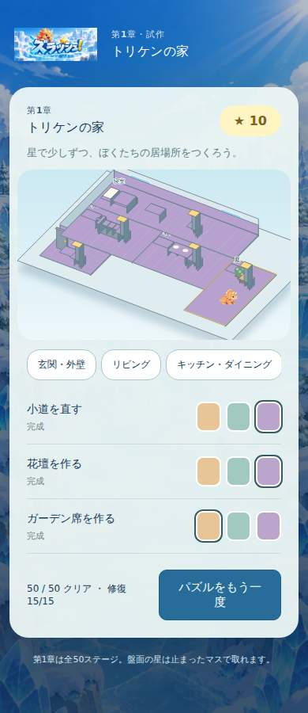

# 第3段階 トリケンの家

正式な第1章の舞台は一つの家と敷地。奥に寝室、中央左にリビング、右にキッチン・ダイニング、手前に玄関、右外に庭を置く。平屋のカットモデルとして床・壁の厚み、窓、出入口、家具を同じ座標で描画し、5エリアの選択で同じ家の中を移動する。トリケンは承認済みの同じ画像を使う。

15タスク（各エリア3）、費用3+2+3個×5＝40個。初回クリア50個の範囲で完成し、装飾変更は無料の3色。修復は任意の順序（各エリア内は前提順序あり）でプレイヤーが実行。修復しなくても全50面と3道具の解放を進められる。

従来の10/20/30面の自動消費は家モードで停止。解放は到達時に無料で行う。旧キーのセーブは元の獲得・建築履歴を残してv2へ移行し、ice-craneをリビングの床、ice-workshopをキッチン調理台、crystal-gateを庭の小道の修復済み支出として充当する。旧9個＋追加31個で40個となり、二重支出はない。旧キーは上書き・削除しない。

v2キー: zurash-app:home-preview:ice-town:v2。建設開始時に一度だけ支出とpendingを保存し、短い建設演出後に完成を保存。途中再開時は同じpendingを完了し、再支出しない。完成家具のタップで同じエリアの装飾操作へ移動する。全50面クリアと全15修復の両方で完成イベントを表示し、既読を保存する。

配置・ソロルール・inventory・攻略手順は変更していない。既存の50面証明を再生成せず、そのまま探索・再生検査する。章の表示名だけを「トリケンの家」へ更新する。家づくりはsrc/puzzle/house.js、描画はsrc/house-view.jsへ分離。章インデックスと恒久IDは継承し、家→ご近所→村→町→都市→国→世界の拡張を維持する。

試遊画面はadventure.html。ホームが家、パズルクリア後に家へ戻り修復できる。公開本番のindex.htmlと元のzurash-gameは変更しない。人間の面白さ検証とiPhone実機はブラウザ代替検証とは区別する。

## 完了時の検証

70単体テストと既存50面の攻略証明の再検査が成功。最新版の [CI](https://github.com/stusaurus/zurash-app/actions/runs/41198122264) では Chromium/WebKit × 320/390/1440px の全6条件が成功した。各条件で全50面をボタン操作し、修復せずに進行、15タスクの手動修復、3色選択、完成イベント、再読込、50面目の再クリアで報酬が増えないことを確認。旧セーブの支出9個の充当、建設途中の復帰、残高不足・重複支出防止は単体テストで確認。

独立した非公開試遊URL： https://zurash-triken-home-playtest.jyoker.chatgpt.site

本番・mainは変更しない。試遊には同じChatGPTアカウントでのログインが必要。配置処理は成功し、このブラウザではログイン画面まで確認。認証後の配信ページ自体の実操作・iPhone実機の検証は未実施だが、配信ファイルとCIで検証したアプリ実行ファイルの一致は確認している。異なるドメインのセーブは自動参照できないため、非公開プレビューは本番とは独立した保存領域で動く。同一配信元に旧キーがある場合に移行する。

修復は実際の床・壁・扉・家具・植栽の描画状態を変更する。完成形の参考画面：

