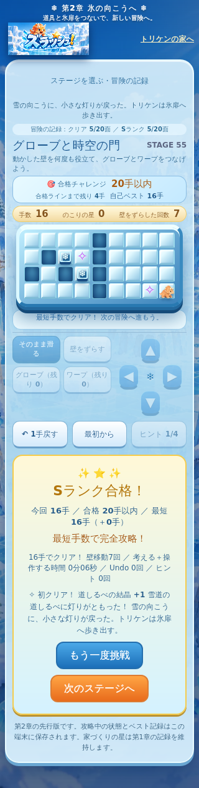
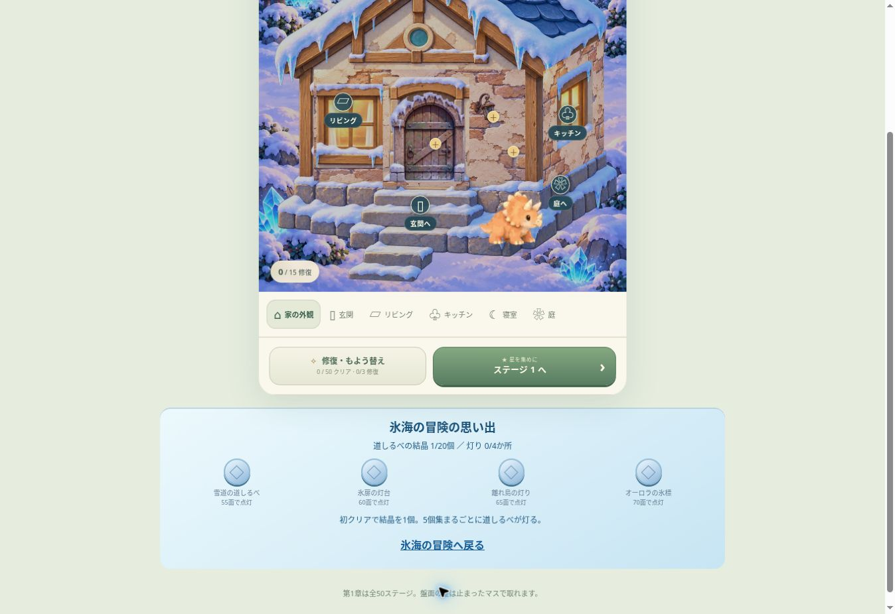

# 第2章：結晶・4つの灯り・家への帰還

第51〜70面の初クリアを、氷海の道しるべを灯す冒険につなげる。パズルの盤面・最短解・アイテム回数を変更しない。

| 到達面 | 思い出 | 初クリアの累計 | 点灯に使う結晶 |
|---|---|---:|---:|
|55|雪道の道しるべ|5|5|
|60|氷扉の灯台|10|5|
|65|離れ島の灯り|15|5|
|70|オーロラの氷標|20|5|

- 通常冒険の初クリア1面につき結晶1個。5個ごとに自動で道しるべを灯し、進行を止める確認ダイアログを増やさない。
- 完了済み面の再挑戦、Undo、保存再開で重複報酬を出さない。Sランクは従来どおり手数の挑戦で、結晶獲得に強制しない。
- 自由試遊の進行は通常冒険の結晶・灯りへ加算しない。
- 信頼済みのv1クリア記録から算出するため、新しい可変の通貨台帳やセーブ形式への移行は不要。既存の進行からも復元する。
- 第1章の家づくりの星、15修復、家具、旧セーブを変更しない。第1章の星を結晶として消費しない。
- ステージ選択内に4つの灯りを表示し、節目の結果画面で物語を進める。70面クリア後は家へ帰る案内を出す。
- 家に戻ると「氷海の冒険の思い出」から点灯状態を見返し、冒険を再開できる。
- 家の思い出は補助表示。通信が遅れている間にパズルを始めても、遅い失敗表示がパズル画面へ割り込まない。

## 検証

`tests/expedition.test.js` は正規エンジンで実際にクリアした20面の記録を使い、20結晶・4点灯、再クリア・Undoの重複防止、旧v1保存の読み込み、自由試遊との分離を確認する。

`tests/adventure/expedition.spec.js` は55面の実操作、点灯、リロード、家への帰還、元の家セーブ不変、自由試遊、遅延通信の分離をChromium/WebKitで確認する。320/390/1440pxの成功画面もCI成果物に保存する。

既存の全20面通しテストにも初クリア報酬と70面の4点灯・章クリア演出を追加した。人間の面白さ評価とiPhone実機確認は引き続き別途必要。

## 最終結果

検証・配信コード：`2054a86762542434dc0506a957c85d414305ca8b`。

- [第1章CI](https://github.com/stusaurus/zurash-app/actions/runs/41422898466)：単体154件、家・美術16件と全50面の6条件が成功。失敗0。
- [第2章CI](https://github.com/stusaurus/zurash-app/actions/runs/41422898416)：単体55件（154件の一部）、ブラウザ56件が成功。失敗0。
- Chromium/WebKit × 320/390/1440px。新しい点灯・帰還テスト8件を含み、既存の全20面通し試験でも結晶と70面の4点灯を確認。
- 更新した8配信ファイルが保存済みコードとSHA-256一致。
- 管理されたプレビューでも51面を8手で操作し、結晶1個、保存・再開、家の思い出への反映、家づくりの星0個の維持を確認。
- iPhone実機は未確認。既存対戦画面全体の補助CIは記録時点で実行中。

通常冒険：[第2章を続ける](https://zurash-triken-home-playtest.jyoker.chatgpt.site/chapter-two?trial=1)。自由試遊は報酬とは別に記録する。

