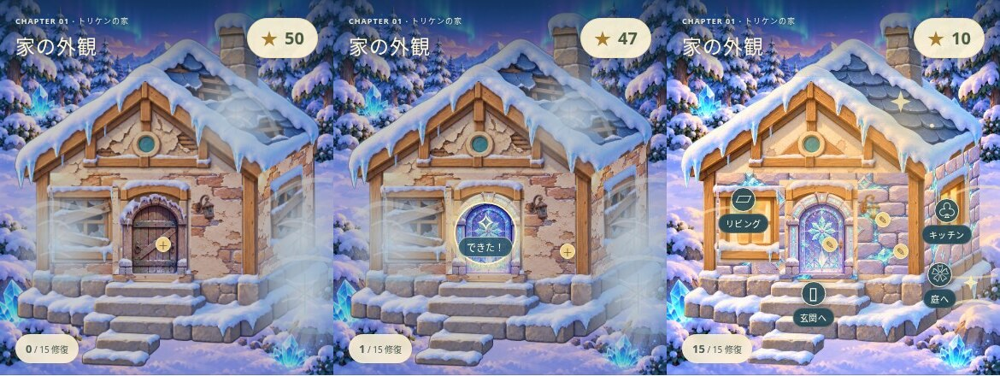

# 家づくり進化：修復の変化と3種類の装飾

基準：main `cdd0cc165f9952a1f5a73b30a15680f5267b9a48`（PR #27）。独立ブランチ `feature/house-restoration-evolution`。本番未公開。

## 調査と採用判断

- 現行 `house-view.js` → `house-scenes.js` → `house-layered-art.js`、v2セーブと15件の修復台帳、解放条件、アートバイブル、素材台帳を確認。
- PR #3/#4/#6/#7/#22〜#27の記録とgit履歴を確認。PR #21の別機能は取り込まない。Issue検索で家づくり関連の追加Issueは見つからなかった。
- 本番の新規状態を実ブラウザで確認し `production-before.jpg` に保存。完成済みの屋根・発光窓を背景に焼き込んだ既存の家シェルが、荒廃感の弱さの原因。
- 6シーンの既存背景と15箇所×4状態（修復前＋a/b/c）の絵を再利用。家具・扉・壁・照明は形状、素材、模様の違う3案がすでにある。問題は素材不足ではなく、3箇所完成後まで選択を隠していたUI。
- `references/house-v7/generated-originals` の保存済み原画12枚も確認。旧 `house-art.js` / `house-room-legacy.js` のベクター描画は現在の主描画ではなく、画風を戻す用途には採用しない。未使用の寝室壁b素材なども、現行の青い板壁より優先する根拠がないため維持。
- 第1章は星40個・15修復・5段階のエリア解放。第2章は別キーに保存する結晶・道しるべの探索報酬と、第1章の家に置く思い出。家の15タスクと同じ経済ではないため、今回統合しない。

## 実装

1. 既存シェルを参照して傷んだ差分1枚を制作。屋根の欠け、剥がれた上部壁、割れて板を打った窓。959×1080 RGBA WebPを既存の480×540カメラへ配置。元画像は保持。`home-entry-1`未修復の間だけ使い、扉や照明を直しても傷みを残す。表示名を「屋根と外壁を直す」に合わせた。屋根・外壁・窓はこの既存タスクの修復対象であり、別料金のタスクは増やさない。
2. 修復直後は直前の全景が0.85秒で消え、実際に変わった箇所を見せる。既存の短い完成アクセントも維持。動きを減らす設定では画像変化を即時表示。
3. 修復直後の「修復まえを見る／今の家を見る」と、常設の「最初とくらべる」。同じ位置・縮尺で全景を切り替える。比較用はメモリ内の複製で、星・家具・進行を実際に巻き戻さない。比較中の家上の入口・編集マーカーは隠す。スライダーより指の精度を必要としないワンタップ方式を採用。
4. 15箇所すべて、修復前から既存の3案をプレビュー。カードを押すだけでは保存しない。「直す」で星消費と選択を一括保存。完成後は「このデザインにする」で無料確定。閉じると未確定プレビューを破棄。家具の拡大図と実際の家の縮小図を並べ、スクロールするシートが家を覆わない構造。
5. カタログを `src/puzzle/house-designs.js` に分離。セーブの整数番号は固定し、末尾にデザインを追加できる。検証・表示・描画で同じカタログを利用。現行は3案、追加には対応する素材も必要。
6. 家全体の暗さは照明の修復に連動させ、扉や壁を直しただけで他の未修復箇所まで明るくならないようにした。

## 画像

左から修復前／扉だけ修復／15か所完成。画面上の星と修復数は、その時点の実セーブ値。

- [旧本番の新規画面](production-before.jpg)
- [新しい修復前](before.jpg)
- [扉だけ修復](door-only.jpg)
- [外まわり3か所完成](exterior-restored.jpg)
- [15か所完成](complete.jpg)
- [完成後に最初を振り返る](initial-revisited.jpg)
- [装飾プレビュー](design-preview.jpg)

自動操作用の獲得済み星fixtureから撮影。50面を実操作する別の通し試験と区別する。PNG原本はテスト添付、ここには容量を抑えたJPEGを保存。

## データ互換と保護対象

- v2セーブキー・既存修復ID・星コスト・報酬・解放条件を維持。既存選択番号を変換しない。選択がない既存セーブは従来のaを表示。
- 任意のスタイル指定を `beginRepair` の同じ保存に含める。中断時はその選択のまま完成。`finishRepair` の再呼び出しや完成済みタスクからは再徴収しない。
- 第1・第2章の認定最短値、クリア判定、ステージデータ、報酬台帳コードには変更なし。最短超過による未クリアと報酬なしをブラウザでも確認。

## 検証記録

- Node単体：302/302成功（家の18件、セーブ互換、認定最短条件、静的公開物を含む）。`npm run check` 成功。静的サイト組み立て成功。
- 家づくり回帰：34/34成功。Chromium/WebKit、320/390/1440pxの新機能、旧シーン操作、5エリア解放、既存装飾、短い完成演出を含む。
- 比較・装飾・選択済み建設中断の追加確認：8/8成功。上の34件と一部重複。
- 最終UI調整と既存操作：14/14成功。Chromium/WebKitの320/390/1440px、新規比較・保存・建設中断と既存ガイド操作を確認。
- 第1章50ステージ＋全15修復：Chromium/WebKit × 320/390/1440px、6/6成功。50面の実操作、全15修復、星残高10、装飾・保存復元まで完走。
- 390px最終プレビュー追試：Chromium/WebKit 2/2成功。画像を目視し、家具と家のプレビュー・3カードがシート内に収まることを確認。
- 第1・第2章の最短超過報酬禁止、遠征報酬・再挑戦・再読込・家の思い出・練習保存分離：10/10成功、Chromium/WebKit。
- 実機iPhone Safariの手動試験は未実施。WebKit自動試験とは別。
- 実行環境ではWebKitの不足共有ライブラリをユーザー領域に配置。検証スクリプト自体を弱めず実ブラウザで実行した。GitHub Actions側は従来の `playwright install --with-deps` を使う。

再実行：`npm test`、`npm run check`、`npx playwright test -c playwright.chapter.config.js --grep 'house evolution|guided house repairs follow|five-room story first chapter celebration|house expansion|house scenes show no arcade mascot|house painted exterior grows|repair success accent|scene controls, pending resume and designs|v7 every repair' --workers=2`。50面通しは `--grep 'all 50 stages, unlock events and reload'`。

## 新規素材の制作記録

`assets/house/v7/backgrounds/house-shell-before-v2.webp`。既存シェル1枚への組み込み画像生成による編集。元シェル・家具・背景は置き換えない。台帳はDraftとして登録、正式な美術承認とは区別。

制作プロンプト：

> Edit target: attached transparent house shell for an existing 2.5D painted fantasy snow-house game. Make a severely neglected but cute repairable version. Preserve canvas aspect ratio, house size, placement, camera, silhouette, door opening, window positions and perspective. Keep snow, wood/blue tile palette and painterly quality. Change roof, upper triangular plaster and windows: missing blue tiles exposing wooden battens within the roof outline, cracked and peeled plaster, boards over broken unlit windows. Main lower front wall remains a separate game texture. No door, furniture, background, text or characters. True transparent background; friendly adventure, no horror.

## 残りと公開条件

- Draft PRで既存アートと新差分の目視確認、全CIの最終結果を確認してから公開判断。今回main・本番には変更しない。
- 屋根差分は同じカメラ領域に配置しているが、生成画像の微細な輪郭・雪の質感は完全なピクセル一致ではない。大きな形状の移動や別建物化がないことをスクリーンショットで確認。
- 室内は既存の傷んだ家具と灯りで差を表現。さらなる荒廃度の追加や、屋根自体の独立3デザインは今回行っていない。まずこの外観・比較・既存3案の操作感を実機で確認する。
