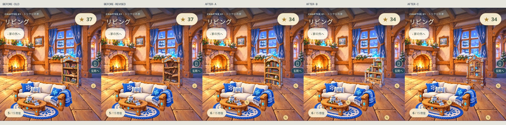

# 家づくり美術・操作の品質審査（2026-11-12）

対象：`stusaurus/zurash-app`。基準main：`158820eb4a0318f375530dc72c863effd39c3116`。

この記録は今回の差分を審査するもので、ゲーム全体を商用完成と認定するものではない。

## 引き継ぎ・採用

- PR #33の公開状態から開始。PR #35（head a48e675）の4 CI、PR #36（head e4f6198）の5 CIすべてsuccessを最新取得して確認。
- #35の54画像をArtifact 13904096654から取得し、6シーン×未修復/A/B/Cと15修復の直前/直後を目視。撮影基盤は実用的なので採用・マージ `42d691c`。
- #36のArtifact 13904806669から、照明修正前後のリビング・キッチン・庭を確認。暖炉、天井灯、空の光と室内の明度を一致させるため採用・マージ `158820e`。棚・コンロ・庭席を修復しても全景が突然明るくならない。玄関灯・読書灯の点灯は維持。
- #36のPages公開 run 43208057759 はsuccess。公開後も実際のファイルと操作を確認する。
- #34の中央拡大クロップは不採用を維持。木枠が平板化し、結晶模様が過大になる変更を、単なるCI成功で再採用しない。

## 今回の制作・実装

### 本棚（Issue #37）

旧修復前は多くの棚板と本が残り、約90px幅の全景では整った家具に見えていた。また修復ボタンが家具の中央を隠していた。

- 新しい修復前1枚：折れた頂部、欠け落ちた棚板、大きな空隙、斜めに残る板、少数の本と落ちた本。破損は木の構造と厚みに沿って描いた。小さな傷・線の重ね合わせではない。
- 元の木の色、青い結晶、右側面が見えるカメラ、幅・高さ・足元を維持。432×640 RGBA WebPへ整備。配置 `[281,217,111,177]` は維持。
- 完成A/B/Cは既存画像をそのまま使用。A＝曲線の木枠と整頓された本、B＝階段形の棚と籐かご、C＝ガラス戸と暗い木。完成3案を作り直す必要はない。
- 修復ボタンは44pxを維持し、棚の右外側へ移動。320pxでも棚の輪郭・空隙を覆わない。既存の操作・修復フローは維持。
- 旧素材も保存。新規未修復表示のみv2へ切り替えるため、完成済みの家・保存番号・星・最短手数・進行は変わらない。

### 美術レビュー基盤

`python3 scripts/house-art-review.py <展開したArtifact> <出力先>` で、Playwright HTMLレポートを54状態の名前付きギャラリーとmanifestへ変換する。標準Pythonのみで動く。元レポートから各PNGをコピーし、`index.html` で一覧にする。CI Artifactに同梱。

manifestの `technical_capture: passed` と `art_review: pending` を分離。自動撮影の成功で美術承認を偽装しない。採否は下表とPRの実画像レビューに記録する。

## 15箇所の観察と優先順位

共通確認：画風・色と光源・パースと縮尺・接地・境界・修復前後・A/B/C。以下は54状態を比較した結果。変更が不要なものは保存する。

|修復|観察できる問題／良い点|判断と次の方針|
|---|---|---|
|扉|Aは木の板、Bは青い窓、Cは結晶ガラス。アーチの外形と開口部に収まり、破損状態との差も大きい|維持。3案とも再制作不要|
|屋根・外壁|屋根と窓の破損は分かる。壁のパネル内木枠と建物の柱が二重に見える箇所がある。B/Cの材質サイズも壁面より大きく見える|次の美術優先1。外枠なしの面材を実際の壁のパースに合わせて制作・審査する。#34の拡大クロップは使わない|
|玄関灯|破損→完成の形と点灯が一致。Aランタン/Bベル/C結晶でシルエットが異なる|維持。#36の本物の点灯効果を保持|
|リビング床|板の穴と完成板張りには差があるが、A/B/Cの床画像は部屋の床の遠近・境界と完全には一致しない|次の美術優先2。床全体の正しい透視面として再制作を検討。傷の線を追加して済ませない|
|ソファ|布の傷みから整った家具への変化が大きい。3案の布・曲線・模様が識別できる|維持。中央の編集マークの重なりは今後のUI監査項目|
|本棚|旧破損は全景でほぼ整った棚に見え、中央マークも重なる|今回改善。構造的な欠損を大きく描き、ボタンを棚外に置く。完成A/B/Cの素材は保持|
|調理台|壊れた棚板と完成天板・扉の差が大きい。奥の調理壁にベクターの亀裂が残るが家具とは別タスクとして解消|維持。壁面の自然な破損描写は床・外壁の後に見直す|
|食卓|欠けた机から食器付きの整った机へ。丸/だ円/八角の3案が読み取れる|維持。床との接触は全案で成立|
|コンロ|壊れた小さな台からほうろう/鋳鉄/結晶のコンロへ変わる。暖色の全景変化が対象の差を埋めていた|#36を採用し解消。既存の接地影と素材を維持|
|ベッド|傷んだ寝具から整った寝具へ大きく変わる。3案の頭板と布が異なる|維持。床接触と木の光源も大きな不整合なし|
|寝室壁紙|破れは大きく分かる。完成パネルの境界・窓下の直線が背景とやや平面的につながる|外壁・床に次ぐ改善候補。A/B/Cを窓と梁に合わせた壁材として制作し直す方針|
|読書灯|消灯・傷んだ状態から灯りと明るさが変化。台座と素材の3案が異なる|維持。点灯の因果と接地を保持|
|庭の小道|未整備から連続した飛び石へ。3案の石・結晶の形が違う|維持。Cは発光の主張が強いため今後の彩度監査対象|
|花壇|枯れた少ない花から白い花・緑の増えた花壇へ。木/石/結晶で区別できる|維持。雪の地面との接続も大崩れなし|
|ガーデン席|壊れた席→整ったテーブルと席の差は明瞭。修復時に空まで暖かくなることが不自然だった|#36を採用し解消。素材自体は維持|

## 比較画像

左から旧修復前／新しい修復前／完成A／B／C。操作ボタンの大きさは維持。

[320pxの比較](bookshelf-comparison-320.jpg)・[PC幅の比較](bookshelf-comparison-1440.jpg)・[照明の新旧](lighting-review.jpg)・[既存6シーンの監査](baseline-six-scenes.jpg)

## 技術と美術の2段階審査

技術：画像取得、欠損/完成の状態、セーブ、星、最短手数、章解放、プレビュー取消、無料変更、44px操作、見切れ、各ブラウザ。既存の単体・50面通し・第2章回帰を利用する。

美術：下記すべてを、実際のリビングの390/320pxの画面と完成A/B/Cで目視する。大きな単体画像だけでは判定しない。

1. 旧素材より未修復の構造が判別できる。
2. 木・結晶・塗りと右側面のパースが周りの暖炉や窓と同じ世界に見える。
3. 床と足元がつながり、家具のサイズが変わらない。
4. 修復前後で棚板の空隙・本の配置・輪郭に分かりやすい差がある。
5. 320pxでもその差と修復マークが重ならない。
6. 完成A/B/Cの3案とも破損から完成への変化が成立する。

判定：今回の本棚差分は上の6項目を満たし採用。全体の商用品質は未達（外壁・床・壁紙の接続が残る）。技術ゲートが揃ったHEADだけマージし、公開後に画像・モジュールの一致と操作を確認する。実機iPhone SafariはIssue #30で継続し、WebKit自動結果と混同しない。

## 検証と再現

- 変更前の公開サイトで320/390/1440pxの初回表示、最初の最短クリア、星1個、帰宅、ステージ選択を直接操作。
- 単体テスト309/309成功。公開バンドルの構築成功。
- 本棚の実ゲーム操作6/6成功（Chromium/WebKit × 320/390/1440px）。旧素材/新素材/完成3案の撮影、未確定では保存不変、修復後34星、無料変更・再読み込みの保持を検証。
- 本棚を含む全15修復・3装飾のガイド／完成比較回帰30/30成功。
- 54状態の既存ギャラリーも同じコードで再撮影し、2/2成功・54枚すべて読み込みを確認。新しいギャラリーを作る場合：`npx playwright test -c playwright.chapter.config.js --project=chromium --grep 'house visual audit' --workers=1` → 上記Pythonコマンド。
- 全15修復のブラウザ検証、50面通し、第2章・最短認定の回帰、CIの最終結果と公開SHAはPRの最終チェックポイントに記録する。

## 素材の制作記録

新規は `assets/house/v7/living/home-living-2-before-v2.webp` の1枚のみ。参照は旧beforeと完成A。組み込み画像生成による既存素材編集、透明PNG出力をWebPへ整備。既存A/B/Cおよび旧beforeは変更していない。

制作プロンプト：

> Use case: precise-object-edit. Asset for ZURASH existing warm painterly 2.5D fantasy wooden-house game, repair BEFORE state, transparent cutout. Image 1 is EDIT TARGET, image 2 is the unchanged REPAIRED style reference. Edit image 1 only. Keep its exact 2:3 canvas, overall bookshelf height/width, front-right three-quarter camera, thick orange oak pillars, bottom feet registration, wood rendering and blue crystal carving palette. Make neglect unmistakable when this sprite is only 90 pixels wide in a room: top central crystal carving snapped and a carved arch section broken away, TWO middle shelves visibly broken out or sagging with large empty gaps, a few loose wooden planks hanging diagonally inside, torn back boards revealing dark gaps, only a few crooked worn books left (no neat rows), two or three fallen books and one splintered shelf board at the base INSIDE the original canvas. Preserve upright recognizable furniture structure and existing feet positions, no extreme tilting. Pale dust, tiny sparse ivy, friendly repairable fairytale neglect, no horror. Model structural broken wood thickness and soft shadows accurately in the same richly painted style, not flat scratches or drawn symbols. Finished reference must remain unchanged. No additional objects outside the bounding box, no room, no floor or background, no text, no character, no checkerboard. Genuinely transparent background.
