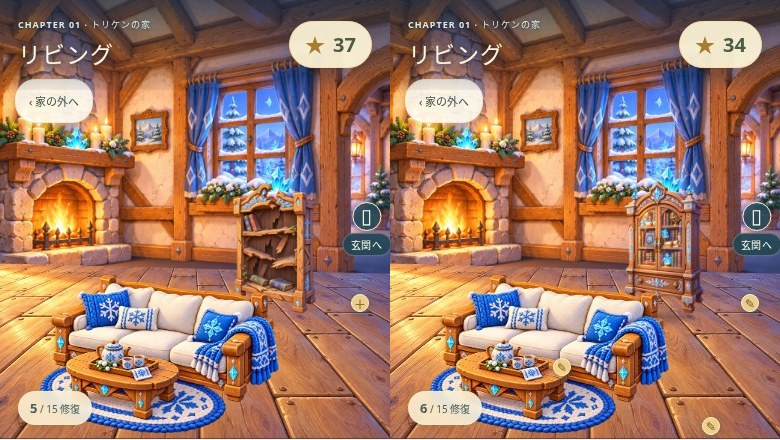

# 本棚改善の公開後QA（2026-11-15）

本番：[ズラッシュ！](https://stusaurus.github.io/zurash-app/adventure.html)

- PR #38をsquash merge：`342d1c57045f317786a9a260c83243f19a7aef54`。
- 同一HEAD `f0cb83a` の7ワークフローは全成功。第2章WebKitの旧失敗は、再実行後に合格を確認。
- Pagesデプロイ：[43689833781](https://github.com/stusaurus/zurash-app/actions/runs/43689833781) success。
- 公開後Guided house：[43689833782](https://github.com/stusaurus/zurash-app/actions/runs/43689833782) success。
- 公開6ファイル（新WebP・家描画・家の操作・保存・第2章保存・認定最短値）は、検証済みソースとバイト一致。
- 公開URLをChromium/WebKit × 320/390/1440pxで実操作し、全6条件で成功。3案プレビュー時は保存不変、修復後の星は37→34、比較拡大の開閉、次の場所へ移動、再読み込み後の選択と残高保持、横幅超過なしを確認。
- 修復対象を開くため獲得済みの試験用セーブを使用。50面を本番で再び獲得したとは主張しない。
- 実機iPhone Safariは未検証。Issue #30を維持。
- mainで自動再実行されるGame qualityの最終結果はPR #38の最新コメントに記録する。

[機械検証記録](qa.json)・[320px WebKitの修復前](webkit-320-before.jpg)・[修復後](webkit-320-after.jpg)

## 品質検査の統合（PR #40）

#40の撮影は320/390px各54枚、両ブラウザ計216枚になる。一方、#38で追加したギャラリー生成は54枚/ブラウザのみを受け入れていたため、そのまま統合すると失敗する。

- ギャラリーを108枚/ブラウザに対応し、各幅54状態の名前まで検証。
- 片方の幅が欠けた場合、無関係な状態への置換、重複、空の撮影を拒否。旧54枚レポートの読込も維持。
- `technical_capture=passed` と `art_review=pending` は引き続き別。画像の差や枚数を美術承認と扱わない。
- Chromium/WebKit 8試験・216画像の実撮影とギャラリー生成が成功。Python回帰5件、本棚のブラウザ6条件も成功。
- 公開検査中のネットワーク遅延で、遷移前の描画準備完了を拾うと撮影要素が切り替わる競合を確認。待機を「描画準備」だけでなく「リビングへの遷移完了」へ変更した。ゲーム本体への変更はない。

本番の変更は本棚のPR #38。品質基盤の採用状況はPR #40の最新CI・コメントを確認する。外壁の不採用試作PR #39は公開していない。
