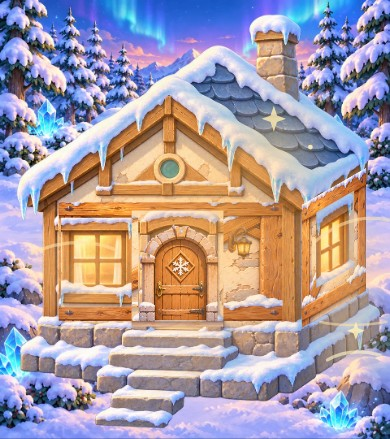
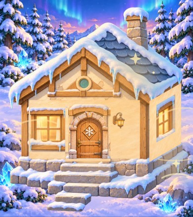
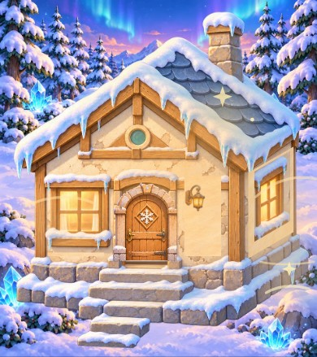

# 外壁Aの面材・構造接合の試作（不採用・Draft）

本棚の検証済み変更とは独立。PR #34の拡大クロップを再導入せず、新しい面材1枚から試した。

## 試したこと

- 現行Aの描画には額縁・斜め梁・雪が焼き込まれ、建物側の柱と二重になるため、既存のクリーム色の漆喰から枠のない修復後面材を制作。
- 1回目：既存のマッピングに面材だけを差し替えた。柱や雪の縁に平面的な塗り面が重なり、窓周りの奥行きも失われた。
- 2回目：塗り壁の範囲を窓枠・扉枠・軒・柱から外し、構造は元の家シェルを保持。東側だけ弱い面の陰影を加えた。修復ID・カメラ・配置・星とセーブは維持。

## 実画面の判定

改善：雪や木枠の二重化は一部減った。

不合格：右側の塗り面が大きな長方形の貼り物に見える。窓枠・木の柱と壁の反射・接触陰影が連続せず、面材の柔らかい粒度と既存シェルの描き込み密度も違う。現行Aの木の量と立体感を弱めており、全体として明確な品質向上とは判断できない。

**結論：本番へ採用しない。B/Cを量産せず、1案で停止。** 技術的には読み込みと描画ができ、家単体テスト19件も成功するが、美術ゲートに不合格のためマージしない。

## 次に必要なこと

- 単なる均一面材ではなく、既存シェルの実際の透視面に合う壁の差分素材として制作する。
- 柱際・窓際の厚みと接触陰影を原画に含め、部屋全景と同じ描写密度で確認する。
- Aが合格してからB/Cへ展開。3案すべてを実画面で審査する。
- 巨大な装飾を中央から切り出す#34の方式には戻らない。

再現：`node scripts/review-wall-surface-study.mjs`。本棚PR #38のHEAD `f0cb83a2448a10654e0cf1a30208a59872d6e0ce` の旧レンダラーを同じページへ返すlegacyと、新しいローカル描画を320/390pxで撮影する。元の家シェル・旧A/B/Cを変更せず、候補面材は `assets/house/v8-surface-study/wall-a-v1.webp` に分離。

新規素材：組み込み画像生成で旧Aの漆喰の塗りを参照し、枠・雪・斜材を持たないクリーム色の塗り面を制作。640×640 RGB WebP。透明背景は不要な面材。採用ではなく、上記不合格理由を再現する試作データである。

制作プロンプト：

> Use case: precise-object-edit. Produce ONE game-ready flat plaster material texture, not a scene. Image1 is the edit target/reference for warm cream plaster paint style. Image2 is ONLY palette / hand-painted 2.5D fantasy wood-house lighting reference. Remove ALL wooden border frame, diagonal braces, snow and stones from image1. Replace the ENTIRE canvas edge-to-edge with beautiful newly restored warm ivory lime plaster: smooth but richly hand-painted with fine trowel grain, subtle warm cream / sandy ochre mottling, gentle hand-painted value variation, NO cracks, holes, peeling or visible damage. Opaque full canvas, square, completely frontal, no perspective and no border. Small-scale material grain suitable for display at 240px wide, soft ambient shading very subtle so it will fit onto an existing 2.5D building model. This is a clean material surface asset, not a wooden panel, no beams, no snowy edges, no fixtures, no icons, no text, no scenery. Painterly storybook game quality matching references, not photorealistic.
